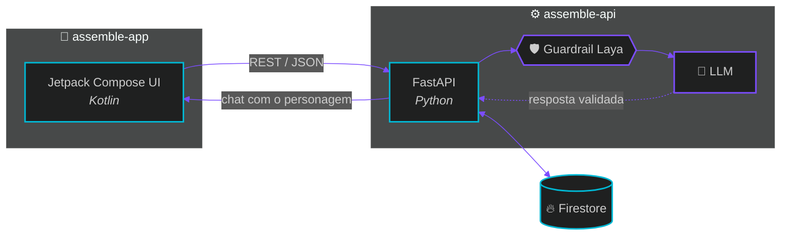
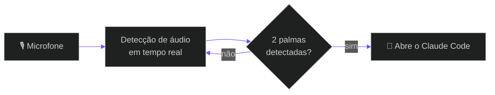
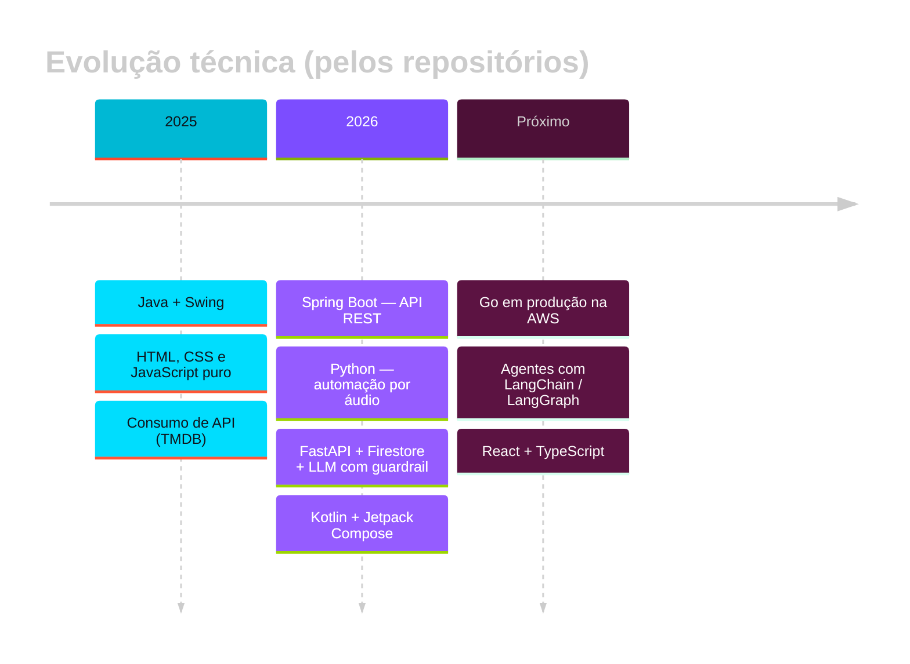

<!-- ═══════════════ HEADER ═══════════════ -->
<div align="center">


<a href="https://github.com/felipeirl">
  
</a>

<br/>

<a href="https://www.linkedin.com/in/felipe-jorge-lopes/"></a>
<a href="https://felipeirl.github.io/portfolio/"></a>
<a href="https://github.com/felipeirl?tab=followers"></a>


</div>

<br/>

<!-- ═══════════════ WHOAMI ═══════════════ -->
## `> whoami`

```ts
const felipe = {
  role:       "Back-End Developer",
  location:   "São Paulo, BR 🇧🇷",
  focus:      ["Go", "REST APIs", "Microsserviços", "AWS"],
  data:       ["MongoDB", "Redis", "PostgreSQL", "Firestore"],
  expanding:  ["AI Engineering (LangChain / LangGraph)", "React + TypeScript"],
  education:  "Técnico · Germinare Tech — Instituto J&F · conclusão 2027",
  philosophy: "Serviços confiáveis, bem testados e simples de operar.",
  status:     "Sistemas online" as const,
};
```

Construo serviços back-end que se mantêm de pé: **APIs REST em Go**, sistemas com dados na **AWS**, ambientes **Dockerizados** e fluxo de trabalho disciplinado com **Git/GitHub**. Hoje estendo esse alicerce para **engenharia de IA** — agentes, guardrails e LLMs em produção — sem abrir mão do básico bem feito: contratos claros, testes e observabilidade.

<br/>

<!-- ═══════════════ STACK ═══════════════ -->
## `> stack --list`

<div align="center">

| Camada | Tecnologias |
|:--|:--|
| **Linguagens** |  |
| **Back-end & APIs** |  &nbsp; |
| **Dados** |  |
| **Cloud & DevOps** |  |
| **Front-end & Mobile** |  &nbsp; |
| **IA** |    |
| **Ferramentas** |  |

</div>

<br/>

<!-- ═══════════════ PROJECTS ═══════════════ -->
## `> ls ./projetos`

<table>
  <tr>
    <td width="50%" valign="top">
      <h3>🦸 <a href="https://github.com/felipeirl/assemble-api">assemble-api</a></h3>
      <p>API do <b>Assemble</b>: FastAPI + Firestore + IA com guardrail <b>Laya</b>. Servidor do app Android.</p>
      
      
      
      
    </td>
    <td width="50%" valign="top">
      <h3>📱 <a href="https://github.com/felipeirl/assemble-app">assemble-app</a></h3>
      <p>App Android para descobrir personagens de quadrinhos e conversar com eles.</p>
      
      
      
    </td>
  </tr>
  <tr>
    <td width="50%" valign="top">
      <h3>👏 <a href="https://github.com/felipeirl/iniciar-jarvis">iniciar-jarvis</a></h3>
      <p>Abre o Claude Code com <b>duas palmas</b>. Detecção de áudio em tempo real para Windows.</p>
      
      
      
    </td>
    <td width="50%" valign="top">
      <h3>🎭 <a href="https://github.com/felipeirl/satire-api">satire-api</a></h3>
      <p>API REST em <b>Spring Boot</b> para um marketplace de bonecos.</p>
      
      
      
    </td>
  </tr>
  <tr>
    <td width="50%" valign="top">
      <h3>🎬 <a href="https://github.com/felipeirl/streaming-lumos-plus">streaming-lumos-plus</a></h3>
      <p>Site de streaming em HTML, CSS e JavaScript puro, consumindo a API do <b>TMDB</b>.</p>
      
      
    </td>
    <td width="50%" valign="top">
      <h3>🧑‍💻 <a href="https://github.com/felipeirl/portfolio">portfolio</a></h3>
      <p>Portfólio profissional — <a href="https://felipeirl.github.io/portfolio/">ver ao vivo</a>.</p>
      
      
      
    </td>
  </tr>
</table>

<br/>

<!-- ═══════════════ ARCHITECTURE ═══════════════ -->
## `> architecture --project assemble`



<details>
<summary><b>👏 Como o <code>iniciar-jarvis</code> funciona</b></summary>

<br/>



</details>

<br/>

<!-- ═══════════════ TIMELINE ═══════════════ -->
## `> git log --stack`



<br/>

<!-- ═══════════════ PACMAN ═══════════════ -->
## `> contributions --play pacman`

<div align="center">

<picture>
  <source media="(prefers-color-scheme: dark)" srcset="https://raw.githubusercontent.com/felipeirl/felipeirl/output/pacman-contribution-graph-dark.svg">
  <source media="(prefers-color-scheme: light)" srcset="https://raw.githubusercontent.com/felipeirl/felipeirl/output/pacman-contribution-graph.svg">
  
</picture>

</div>

<br/>

<!-- ═══════════════ STATS ═══════════════ -->
## `> stats --github`

<div align="center">


</div>

<br/>

<!-- ═══════════════ NOW ═══════════════ -->
## `> now`

- 🔭 **Aprofundando** serviços em Go, REST APIs e microsserviços
- 🧠 **Explorando** agentes com LangChain e LangGraph
- 🎨 **Evoluindo** no front-end com React e TypeScript
- 🎓 **Cursando** formação técnica no Instituto J&F — Germinare Tech (2027)
- 🤝 **Aberto a** oportunidades e conversas sobre back-end e IA aplicada

<br/>

<!-- ═══════════════ FOOTER ═══════════════ -->
<div align="center">

<a href="https://www.linkedin.com/in/felipe-jorge-lopes/"></a>


</div>
